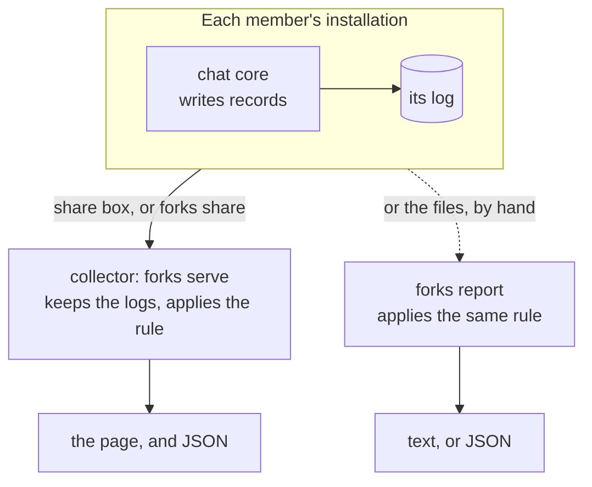
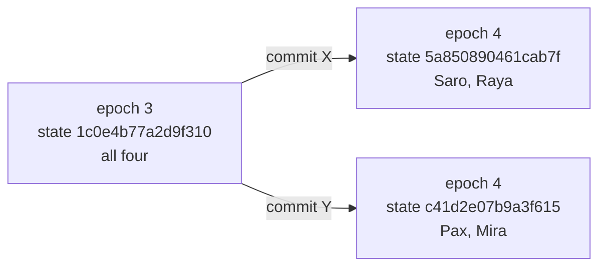
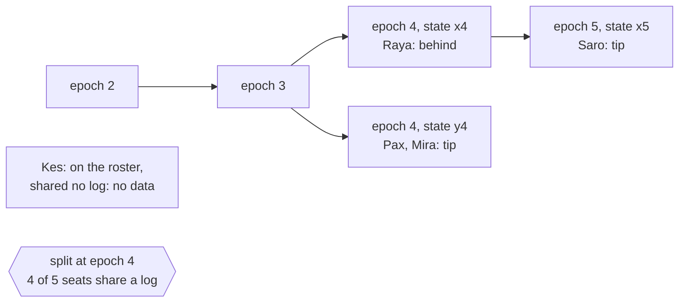
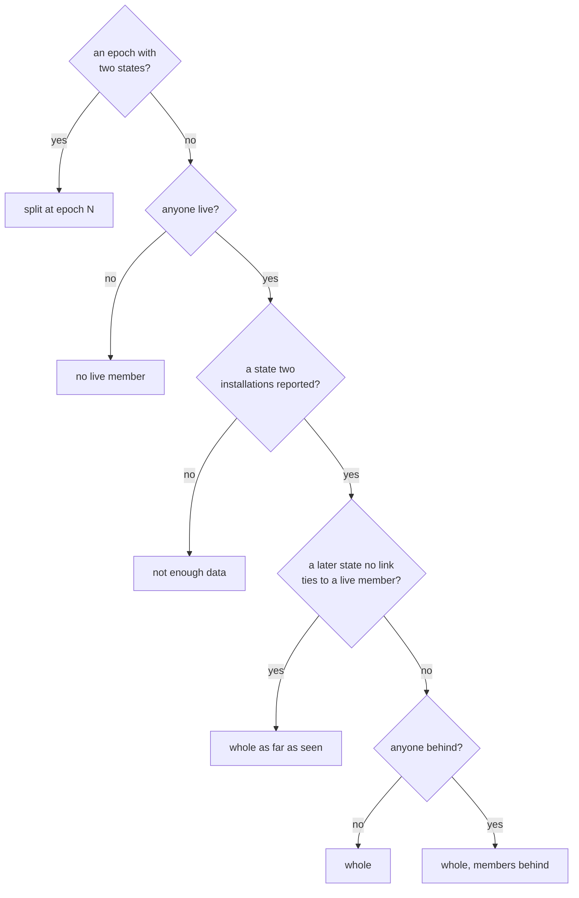

A GroupV2 conversation moves from epoch to epoch as its members apply commits. When two members apply
different commits at the same epoch the group forks: each side goes on, and neither can read what the other
sends. No member can see that from where it stands. It takes several members' states side by side.



## A state, not an epoch number



Both sides reach epoch 4. The number says nothing about which group a member holds, so every record of an
epoch carries a **state**: 8 bytes of BLAKE2b over the MLS epoch authenticator.

- **Same commits, same state.** Every member of an epoch derives the same epoch authenticator, and members
  that applied different commits derive different ones. A fork shows as two states at one epoch.
- **Hashed, because the authenticator is a secret.** The record carries the hash, never the authenticator.
- **Short ids.** An installation is the first 4 bytes of its public signing key (`7b1e44d9`), an account the
  first 4 bytes of its id. A post is named by a hash of its frame, the same at the sender and every reader.

## What each member writes

The chat core writes one line per event on the log target `libchat::groupv2trace`, at `info`:

```text
2026-10-14T12:05:40.250000Z  INFO libchat::groupv2trace: epoch installation=51e55f2c convo=c97b8bdf9a epoch=1 state=f5c9c15c49fac915 members=3 roster=7426eb33:7361726f,51e55f2c:72617961,69c76448:706178
```

`run`, `epoch` and `left` decide the verdict. `sent`, `received`, `unreadable` and the app's `delivery`
add what the page draws: what became of each post, and when a member was offline. The records carry ids,
epochs, states and times, and no message text. [Records](../reference/records/) lists every field.

## How the logs reach one place

| From | How |
|---|---|
| the app | the share box in the Logs dialog: **Share now** sends every run, **Keep sharing** sends what the current run gains every 30 s |
| a terminal | `forks share --to ADDRESS DIR` sends a directory of logs, and on the next go only what they gained |
| files in hand | `forks report FILES` reads them with no collector |

The **share address** is the collector's address with its token. Whoever holds it can send logs and read
every report. Writes are append-only by offset, so a sender that restarts goes on where the collector
stopped and nothing arrives twice.

## The rule



1. **Links make lines.** Two `epoch` records one installation wrote one after the other, in one run, the
   second at a later epoch, are a link: the second state came from the first. A `run` record or a leave
   breaks the chain.
2. **Two states at one epoch is a split.** The states after it group into branches along their links. The
   branch with more installations is `A`. The letter says nothing about which side is right.
3. **Every seat gets a position.** A seat is an installation that wrote in the conversation or that a roster
   lists. `tip`, `behind` and `lineage unknown` are live. `removed`, `ended`, `never joined` and `no data`
   are not. [Read the report](../read-the-report/) defines each one.
4. **The conversation gets one verdict,** the first that holds:



Only `whole` is a clean bill. Under every verdict a coverage line says how many seats shared a log: the
fewer, the less a `whole` is worth.

## What it does not do

- **It sees only what is shared.** One member's log alone cannot show a split.
- **It reports and does not repair.** Nothing here changes how a group behaves.
- **The share address is the trust boundary.** The collector keeps each log whole, as sent.
