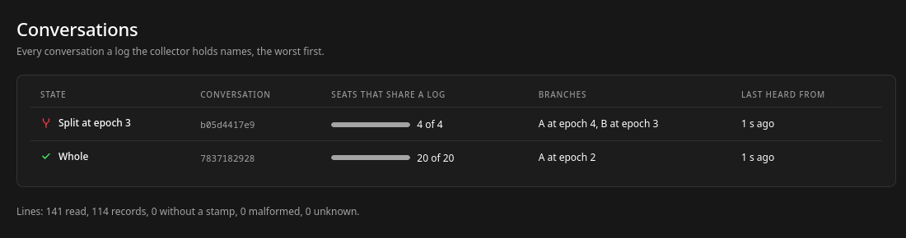
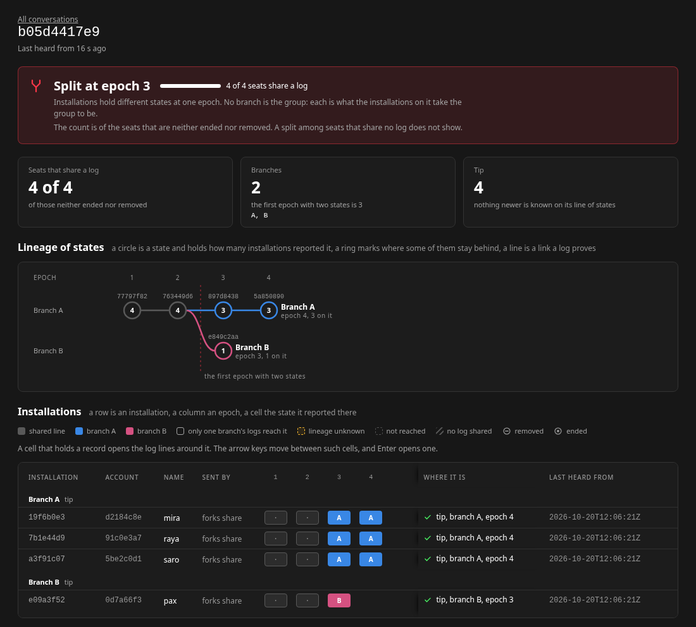
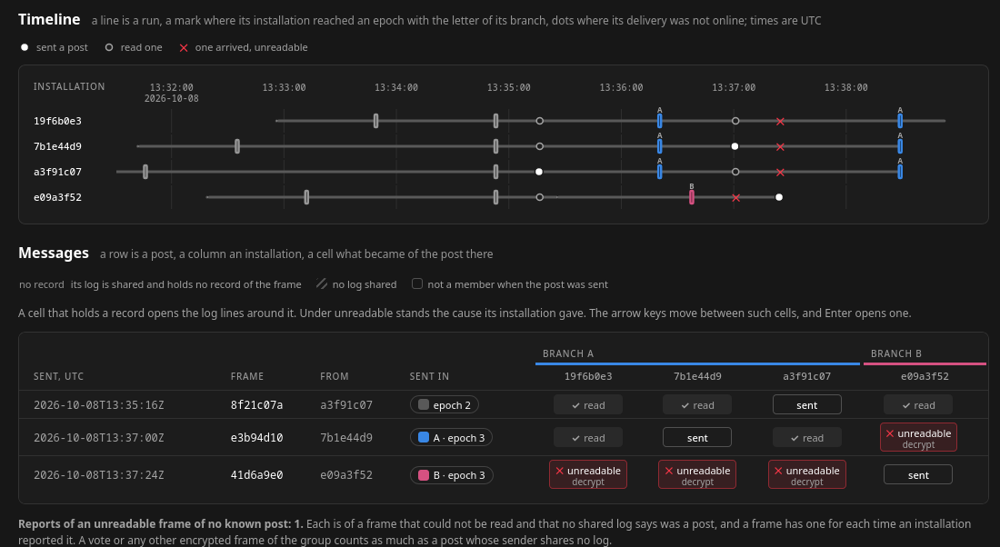

## The text report

Four members, Saro, Raya, Pax and Mira, from the tool's test fixtures. Pax applied a different commit at
epoch 3:

```sh
python3 tools/forks report \
  tools/forks/tests/fixtures/histories/split-at-an-epoch/
```

```text
conversation b05d4417e9
  split at epoch 3
  4 of 4 seats share a log

  branch A: epoch 4, state 5a850890461cab7f, 4 members
    first state at epoch 3, made by commit c41f9be27a6d03e5 by a3f91c07
    on it: 19f6b0e3, 7b1e44d9, a3f91c07
  branch B: epoch 3, state e849c2aa9ab1f74d, 4 members
    first state at epoch 3, made by commit 77b0a1c2d3e4f5a6 by 7b1e44d9
    on it: e09a3f52

  installation  account   name  epoch  position  branch
  19f6b0e3      d2184c8e  mira  4      tip       A
  7b1e44d9      91c0e3a7  raya  4      tip       A
  a3f91c07      5be2c0d1  saro  4      tip       A
  e09a3f52      0d7a66f3  pax   3      tip       B

lines: 69 read, 42 records, 0 without a stamp, 0 malformed, 0 unknown
```

| Line | Says |
|---|---|
| `conversation` | the conversation id; one block per conversation in the logs |
| verdict | one of the verdicts below |
| `S of T seats share a log` | T counts the seats neither removed nor ended, S those of them whose log is here. The lower S, the less a `whole` is worth |
| `branch` | the newest state on each branch, its roster's size, and who is on it. Without a split there is one branch, `A`. A branch can have `nobody` on it |
| `first state` | with a split, the commit that made a branch's first state and the installation that committed it, where the logs name one |
| the table | every seat: its newest epoch, its position, its branch. `name` lists the runs it wrote in, each its log's file name without `.log`; a one-process run writes every member into `group.log`, so each shows `group` |
| `lines` | what was read. Malformed records are skipped and counted in a line above this one, and the report exits 1 |

## Positions

Every seat gets one. The report lists them in this order:

| Position | Live | The seat |
|---|---|---|
| `tip` | yes | holds the newest state of its line |
| `behind` | yes | holds a state that others' links lead on from |
| `lineage unknown` | yes | holds a state, and the logs hold a later one that no link ties to it |
| `ended` | no | wrote only in runs the app marked final when it sent them; files never are |
| `removed` | no | wrote `left`, or the newest rosters leave it out |
| `never joined` | no | shared a log and never held the conversation |
| `no data` | no | is on a roster and shared no log |

The checks run in another order. A seat that never wrote an `epoch` record is `removed`, `never joined` or
`no data` (on the collector, also `ended`). For the others, `removed` comes first, then `ended`, then the live three.

## Verdicts

The first that holds:

| Verdict | Means |
|---|---|
| `split at epoch N` | two states at epoch N, both from one state at N-1 in the logs |
| `split seen from epoch N` | two states at epoch N, and the logs do not show the one they left |
| `no live member` | no seat is `tip`, `behind` or `lineage unknown` |
| `not enough data` | no state was reported by two installations |
| `whole as far as seen` | one line, and a later state that a live member's links do not reach |
| `whole` | one line, every live member at its tip |
| `whole, members behind` | one line, some live members behind |

A split adds `, one side live` or `, no side live` when fewer than two of its sides hold a live member.
Only `whole` exits 0.

## The page

`forks serve` draws the same report. The list puts the worst conversation first:



A conversation opens to its verdict, the lineage of its states, and where each installation stands at each
epoch:



Below them, the timeline and what became of each post. `unreadable` carries the cause its reader gave:
`epoch` (of another epoch), `decrypt` (did not decrypt) or `sender` (the sender could not be checked).
A cell that holds a record opens the log lines around it.



| A post's cell | Means |
|---|---|
| `sent`, `read`, `unreadable` | what that installation's log recorded |
| no record | its log is shared and holds no record of the frame |
| no log shared | its installation shared no log |
| not a member | it was not a member when the post was sent |

## JSON

`forks report --json FILE` writes `lines` and `conversations`. Each conversation has its `verdict`,
`split_epoch`, `coverage`, `branches`, `installations`, `messages` and the rest of what the page draws. The
collector serves it at `GET /conversations/ID`, with each run under the collector's id.
