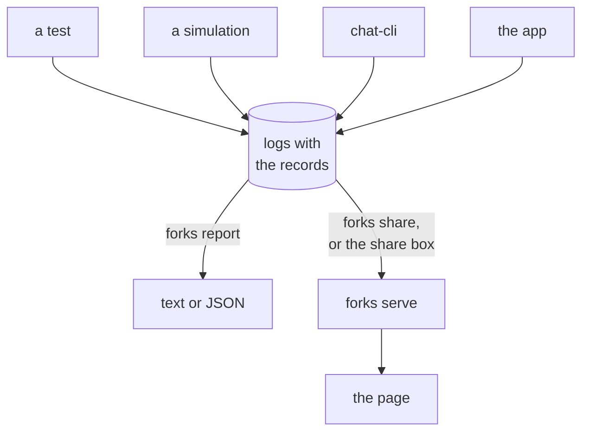

Every command runs from the root of a logos-chat checkout.



| To | You need |
|---|---|
| read logs, run the collector, run a simulation | Python 3.9 or newer; `tools/forks` and `tools/sim` use the standard library alone |
| run a test, or a simulation in one process | Rust stable and `protoc` |
| run chat-cli | Nix: chat-cli links logos-delivery |

## 1. Get logs that hold the records

The records are `info` lines on the target `libchat::report`. Every source below lets them through.

**A test.** The GroupV2 tests in `integration_tests_core` print the records with `LOG=info` (or `debug`),
and only under `--nocapture`:

```sh
LOG=info cargo test -p integration_tests_core --test test_group_v2_scale \
  -- --nocapture --test-threads=1 > scale.log 2>&1
```

**A simulation.** One process runs every member on a virtual clock and writes `group.log`:

```sh
cargo build --release -p integration_tests_core --bin harness-run
python3 tools/sim run tools/sim/scenarios/three.json \
  --one-process target/release/harness-run --out tmp/three
```

[Simulations](../simulations/) covers scenarios, sweeps and a network of chat-cli peers.

**chat-cli.** `--headless --log-file FILE` writes the records unless `RUST_LOG` names another filter;
`FILE` must not exist. The terminal UI writes them with
`RUST_LOG=warn,libchat::report=info` and `--log-file FILE`; without `--log-file` it logs nothing. Two
peers on the file transport meet through one `--data` directory; give both `--registry-url` of a mock
registry (`python3 .github/scripts/mock-registry.py` listens on `http://127.0.0.1:18080`).

**The app.** With the logos-chat-module and logos-chat-ui pull requests, each run of the app writes
`chat_module_<stamp>.log`, with `.NNN.log` parts as it grows, and the ten newest runs are kept. **Show
logs**, at the foot of the window, opens a dialog that shows the folder.

## 2. Read them

```sh
python3 tools/forks report tmp/three/group.log
```

```text
conversation c97b8bdf9a
  whole
  3 of 3 seats share a log

  branch A: epoch 1, state f5c9c15c49fac915, 3 members
    on it: 51e55f2c, 69c76448, 7426eb33

  installation  account   name   epoch  position  branch
  51e55f2c      72617961  group  1      tip       A
  69c76448      706178    group  1      tip       A
  7426eb33      7361726f  group  1      tip       A

lines: 10 read, 10 records, 0 without a stamp, 0 malformed, 0 unknown
```

A `PATH` is a log, or a directory, which stands for every `.log` file directly in it. Give each member's
log, or all of them in one directory. A run is named by its file name without `.log`, and the parts of a
run (`.001.log` and on) read as one. Two runs with one name are refused, even from two directories: read
them one directory at a time. `--json FILE` also writes the report as JSON.

| Exit | When |
|---|---|
| 0 | every conversation reads `whole` and no record was malformed |
| 1 | any other verdict, no conversation, or a malformed record |
| 2 | the logs cannot be read |

So `whole, members behind` exits 1. [Read the report](../read-the-report/) explains every line.

## 3. Collect them

The collector keeps the logs members send and serves the report as a page and as JSON.

```sh
python3 -c 'import secrets; print(secrets.token_urlsafe(24))' > forks-token
python3 tools/forks serve --data forks-data --token-file forks-token
```

It listens on `127.0.0.1:8750`. The **share address** is `http://127.0.0.1:8750/?token=` and the token.
Send a directory of logs to it:

```sh
python3 tools/forks share --to "http://127.0.0.1:8750/?token=$(cat forks-token)" \
  tmp/three
```

Open the share address in a browser: the collector sets a cookie and shows the page. In the app, open
**Show logs**; at the top of its **Full logs** tab, **Share logs** asks for your name and the share
address once, then sends with **Share now**, or every 30 s with **Keep sharing** on.

- **Sharing again sends only what is new.** `share` leaves its receipt in `.forks-share.json` in each
  directory it sent from.
- **Off this machine,** pass `--bind` an address the others reach. The collector speaks plain HTTP, so the
  token and the logs travel in the clear unless something in front of it adds TLS.
- **Whoever holds the share address** can send logs and read every report. A run the collector has not
  heard from for 30 days is deleted.

`python3 tools/sim run ... --share ADDRESS` sends a run's logs as its last step.

## Run the tool's own tests

```sh
python3 -m unittest discover -s tools/forks
python3 -m unittest discover -s tools/sim
```
