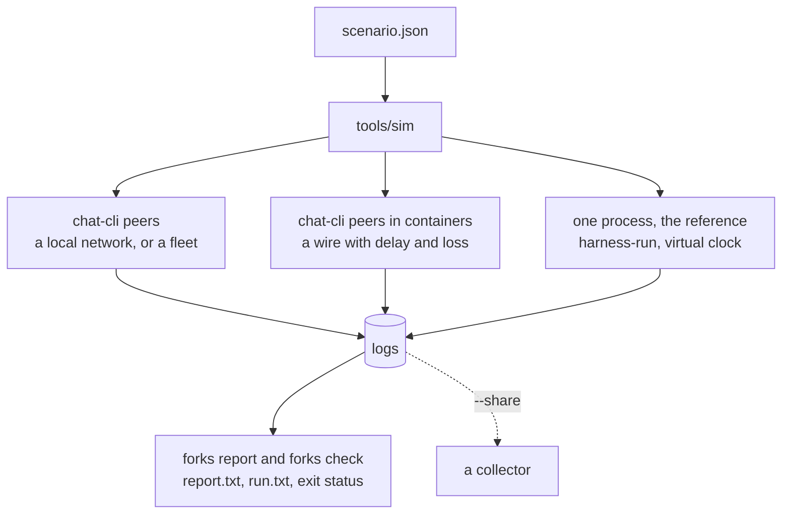

`tools/sim` runs a group the way a scenario file says, on a local network: a headless chat-cli for each
member, each with its own delivery node, on a network that holds the run's nodes and no other. It
collects every member's log and holds the fork report against what the scenario expects. In containers,
each member has an address of its own and a wire that delays and loses what it sends. In one process, a
scenario and its seed give the same run every time, which makes it the reference a change is held to.



## Four ways to run

| | Local network | Containers | One process | Fleet |
|---|---|---|---|---|
| Flag | `--chat-cli PATH` | `--image IMAGE` | `--one-process PATH` | `--chat-cli PATH`, and `preset` in the scenario |
| Members | a headless chat-cli each, with its own delivery node, and a mock registry | the same, each in a container at an address of its own | clients in one process | chat-cli peers on `logos.test` |
| Time | real | real | a virtual clock: seconds of group timers in milliseconds | real |
| Seeds | fix what the network model and the wire drop | the same | fix the whole run, on Linux | fix the network model |
| For | the real network stack, up to 50 members on one machine | the same over a wire with delay, jitter and loss, on Linux or a Mac | the group layer alone, the same run every time | the public fleet; not reproducible |

## A first run

```sh
nix run .#groupv2-simulation-processes -- run tools/sim/scenarios/three.json --out tmp/three
```

Each rig is an app of the flake, which builds what the rig needs from the checkout and runs `tools/sim` with
it; what follows `--` is the sim's command line, less the rig's flag:

| App | Rig |
|---|---|
| `groupv2-simulation` | one process |
| `groupv2-simulation-processes` | a local network of chat-cli peers |
| `groupv2-simulation-containers` | containers, after loading the image into the engine `--engine` names; Linux only |

```text
3 members, fast group timers, largest message 512 KiB
whole: 3 of 3 members at the tip
the report is as expected
load average 0.45 at the start, 0.42 at the end

node   ready   start  dials  wired  mesh  end  mesh  dialed  failed  refused  dropped  errors  exit
saro  0.089s  0.089s      0      2     2    2     2       0       0        0        0       0     0
raya  0.195s  0.105s      1      2     2    2     2       1       0        0        0       0     0
pax   0.394s  0.199s      2      2     2    2     2       2       0        0        0       0     0

batch  joiners  members  joined  seated  Welcome bytes
1            2        3  0.534s  0.534s       2 x 7121

post  from  read by  median   worst  delivered   worst  lookup
1      pax   2 of 2  0.007s  0.007s     0.007s  0.007s  0.000s
```

The sim starts a mock registry and the peers one after another, each node dialing nodes started before it,
and waits until the nodes are linked.

- The head says the verdict, how many members are at the tip, and whether the report is as expected.
- `node` is each peer: when it was ready and how long it took to start, how many nodes it dialed, its links
  and gossip mesh once wired and at the end, publishes its node `refused`, frames it `dropped` inbound,
  frames its member rejected (`errors`), and how it ended. `dialed` and `failed` are the node's own counts,
  and they also count dials back that leave no link.
- `batch` is each `/add`: how many joined, the group's size after it, how long until the last joiner
  joined and until every member held the roster, and the size of each Welcome.
- `post` is each post: how many read it and how long they took. `delivered` is until each reader's lookup
  of the sender reached the registry, `lookup` the lookup itself.

`--out` must not exist. It holds a `<name>.log` per member (`group.log` in one process), `report.txt` and
`report.json` (the fork report), `expect.json` (what the report was held to), `run.txt` (what was printed)
and `run.json` (the same and more, for scripts).

| Exit | When |
|---|---|
| 0 | every step was done and the report is as the scenario expects |
| 1 | a step was not done, or the report differs |
| 2 | the command line or the scenario is refused; nothing started |
| 128 + n | signal n stopped it; what it measured is written |

A run is judged by the check, not by the report's own exit status: a scenario may expect a verdict other
than `whole`.

## Fifty members

On Linux, give a run of many peers a network namespace of its own: its nodes share ports and loopback with
nothing else on the machine, and reach no other network.

```sh
nix develop -c unshare -rn sh -c 'ip link set lo up && exec "$@"' sim \
  python3 tools/sim run tools/sim/scenarios/fifty-sized.json --chat-cli target/release/chat-cli --out tmp/fifty
```

```text
50 members, group timers voting_delay 1000 ms, consensus_timeout 17500 ms, commit_batch_window 13500 ms, freeze_duration 6500 ms, proposal_expiration 26000 ms, largest message 512 KiB
whole: 50 of 50 members at the tip
the report is as expected
load average 0.13 at the start, 14.27 at the end

node     ready   start  dials  wired  mesh  end  mesh  dialed  failed  refused  dropped  errors                   exit
saro    0.103s  0.103s      0      6     6    6     3      10      10        0        0       0                      0
raya    0.195s  0.091s      1      6     6    6     5      10       9        0        0       0                      0
pax     0.285s  0.090s      1      6     6    6     6      13      12        0        0       0                      0
...
peer48  5.060s  0.105s      5      6     6    6     6       6       1        0        0       0  signal 11 in its stop
peer49  5.170s  0.110s      5      6     6    6     6       6       1        0        0       0                      0
peer50  5.288s  0.117s      6      6     6    6     6       6       0        0        0       0                      0

batch  joiners  members   joined   seated  Welcome bytes
1           10       11  14.171s  14.170s     10 x 28222
2           10       21  15.931s  15.901s     10 x 42191
3           10       31  16.976s  16.968s     10 x 56117
4           10       41  19.836s  19.818s     10 x 70077
5            9       50  18.481s  18.480s      9 x 81290

post    from   read by  median   worst  delivered   worst  lookup
1     peer50  49 of 49  0.036s  0.041s     0.026s  0.037s  0.008s
```

- **Six links a node.** From seven members up every node links to six others, the mesh degree gossipsub aims
  for.
- **Timers sized for fifty.** `fifty-sized.json` gives five durations, each twice what a group of fifty
  needed on one machine; `tools/sim/README.md` shows how they were read from the logs. A run takes about a
  minute and a half, where on the library's own timers each epoch takes over a minute (see
  [Reference runs](#reference-runs-fifty-epochs-as-the-module-runs-them)).
- **Not every run is whole.** On a machine of 16 cores, 16 of 20 runs went as expected, and the four
  others ended `whole, members behind`, with 3 to 10 members that did not come to hold a batch's roster
  within the budget.
- **`signal 11 in its stop`** is the delivery library crashing as the peer stops, after the run has asked
  its node for the last time. It happens in larger runs and changes nothing the run measured.

## In containers, on a lossy wire

```sh
nix run .#groupv2-simulation-containers -- run tools/sim/scenarios/lossy-wire.json \
  --engine podman --out tmp/lossy-wire
```

```text
5 members, fast group timers, largest message 512 KiB, containers of logos-chat-sim:latest on podman, wire seed 1, delay 40 ms, jitter 10 ms, loss 0.02
whole: 5 of 5 members at the tip
the report is as expected
load average 0.11 at the start, 0.18 at the end

node   ready   start  dials  wired  mesh  end  mesh  dialed  failed  refused  dropped  errors  exit
saro  0.334s  0.334s      0      4     4    4     4       0       0        0        0       0     0
raya  1.245s  0.631s      1      4     4    4     4       1       0        0        0       0     0
pax   2.460s  0.937s      2      4     4    4     4       2       0        0        0       0     0
mira  3.424s  0.689s      3      4     4    4     4       3       0        0        0       0     0
kes   4.406s  0.676s      4      4     4    4     4       4       0        0        0       0     0

batch  joiners  members  joined  seated  Welcome bytes
1            2        3  0.861s  0.860s       2 x 7121
2            2        5  1.078s  1.063s       2 x 9913

post  from  read by  median   worst  delivered   worst  lookup
1     saro   4 of 4  0.094s  0.111s     0.093s  0.111s  0.001s
2     raya   4 of 4  0.092s  0.110s     0.092s  0.110s  0.001s
3      pax   4 of 4  0.096s  0.118s     0.095s  0.117s  0.001s
4     mira   4 of 4  0.091s  0.107s     0.090s  0.106s  0.001s
5      kes   4 of 4  0.087s  0.092s     0.087s  0.092s  0.001s
```

`.#sim-image` is an image with chat-cli, Python for the registry, and `tc`. With `--image`, the registry
and each peer run in a container of their own on a network made for the run, which reaches nothing outside
it, and each node listens at its container's address. Docker runs the containers, or Podman with
`--engine podman`. The run removes its containers and its network when it ends.

The scenario's `wire` puts `netem` on each member's interface once the member is ready:

```json
"wire": {"seed": 1, "delay_ms": 40, "jitter_ms": 10, "loss": 0.02}
```

- **`delay_ms`** holds each packet a member sends, one number for all or by name, and **`jitter_ms`**
  varies it either way. A round trip carries both ends' delays: the posts above took about 0.09 s,
  where the same five on a bare wire took 0.003 to 0.012 s.
- **`loss`** drops a share of the packets a member sends, drawn from `seed` and the member's name. TCP sends
  a lost packet again, so the frame arrives late. `network`'s loss, which a frame does not survive, still
  works in containers, and a scenario may have both.
- `wire` needs `--image`, and a scenario with `preset` is refused with it.

Fifty members in containers went whole on one machine of 16 cores, each peer taking about 0.35 s to start.

On a Mac the engine runs its containers in a Linux virtual machine, and the image is built in a container
of `nixos/nix`, from the repository root:

```sh
docker run --rm -v "$PWD":/src -w /src nixos/nix sh -c "
  printf '[safe]\n\tdirectory = /src\n' > /root/.gitconfig &&
  nix --extra-experimental-features 'nix-command flakes' --accept-flake-config \
    build .#sim-image -o /tmp/image && /tmp/image" | docker load
```

No cache holds the delivery library for arm64 Linux, so on Apple silicon the first build compiles it.

## A scenario

```json
{
  "members": 4,
  "budget": 33,
  "network": {"seed": 1, "loss": 0.02, "delay_ms": 40},
  "steps": [
    {"step": "seat", "to": 4, "batch": 2},
    {"step": "post", "from": "all"}
  ]
}
```

Members are named `saro`, `raya`, `pax`, `mira`, `kes`, `tomo`, then `peer7` on. `saro` creates the
group. This one, saved as `four.json`, seats the others two at a time, has every peer lose 2% of the frames
it receives and hold the rest for 40 ms, and has every member post:

```text
4 members, fast group timers, largest message 512 KiB, network seed 1, loss 0.02, welcome loss 0
whole: 4 of 4 members at the tip
the report is as expected
load average 0.38 at the start, 0.38 at the end

node   ready   start  dials  wired  mesh  end  mesh  dialed  failed  refused  dropped  lost  errors  exit
saro  0.095s  0.095s      0      3     3    3     3       0       0        0        0     1       0     0
raya  0.184s  0.089s      1      3     3    3     3       1       0        0        0     0       0     0
pax   0.287s  0.102s      2      3     3    3     3       2       0        0        0     0       0     0
mira  0.384s  0.097s      3      3     3    3     3       3       0        0        0     0       0     0

batch  joiners  members  joined  seated  Welcome bytes
1            2        3  0.610s  0.610s       2 x 7121
2            1        4  0.698s  0.697s       1 x 7276

post  from  read by  median   worst  delivered   worst  lookup
1     saro   3 of 3  0.043s  0.043s     0.042s  0.042s  0.001s
2     raya   3 of 3  0.044s  0.044s     0.043s  0.043s  0.001s
3      pax   3 of 3  0.044s  0.044s     0.043s  0.043s  0.001s
4     mira   3 of 3  0.044s  0.044s     0.043s  0.043s  0.001s
```

With `network`, each peer puts what it receives through chat-cli's model of a lossy network, between its
node and its client, and `lost` counts the frames the model dropped. Nothing brings a lost frame back: the
local network has no store node. A wait that a lost frame leaves open runs to the end of its `budget`,
which is why `four.json` sets 33 s in place of 180.

| Field | Default | Holds |
|---|---|---|
| `members` | | how many members start |
| `steps` | | what they do, in order |
| `timers` | `fast` | `fast`, `default`, or durations in ms over the default set |
| `budget` | `180` | seconds each wait may take |
| `seed` | `0` | what a run in one process draws every random number from |
| `max_message_kib` | `512` | the largest message a node takes; not with `preset`, and no effect in one process |
| `network` | none | `seed`, `loss`, `welcome_loss`, `delay_ms` (one number, or by name) |
| `wire` | none | `seed`, `delay_ms` (one number, or by name), `jitter_ms`, `loss`; needs `--image` |
| `preset` | none | a fleet to join, such as `logos.test` |
| `expect` | a whole group | how the outcome differs: `verdict`, `positions` by name, `posts` by name |

| Step | Does |
|---|---|
| `seat` `to` `batch` | Saro adds members, `batch` at a time (10 by default), until the group holds `to` |
| `post` `from` | a member posts (`last` seated by default, or `all`), and the others wait for it |
| `hold` `seconds` | nothing, for a while |
| `cut` `between`, `heal` | cut two sides off from each other, and end the cut; need `network` |

Every field is checked before anything starts. The full format, with every field and step, is in
`tools/sim/README.md`.

## Scenarios to start from

| Scenario | Does |
|---|---|
| `three.json` | 3 members in one batch, one post; CI runs it over a local network |
| `twenty.json` | 20 members in two batches of 10 |
| `50-epochs.json` | 51 members one at a time, fifty epochs, on the library's own timers, as logos-chat-module runs a group |
| `50-epochs-waku.json` | the same, each member's frames held for a delay Waku relay was measured at |
| `50-epochs-waku-loss.json` | the same, with 5% of each member's frames lost, a rate assumed |
| `fifty-sized.json` | 50 members, with timers sized for fifty |
| `lossy.json` | 5 members one at a time, with 5% of frames lost |
| `lossy-wire.json` | 5 members two at a time on a wire of 40 ms, 10 ms of jitter and 2% loss, each posting; CI runs it in containers |
| `fleet-five.json` | 5 members on `logos.test`, held for 300 s |

## Sweeps

`sweep` does a scenario `--runs K` times and prints a row as each ends. Run k takes the seed
`seed + k - 1`, and so it does with the seed of `network` and of `wire`. The row names each seed that
applies: `seed` in one process, `network seed`, `wire seed`.

```sh
nix run .#groupv2-simulation-processes -- sweep four.json --runs 5 --out tmp/four-sweep
```

```text
run  seconds  at the tip  verdict                 check
  1      3.2      4 of 4  whole                   as expected; network seed 1
  2      3.2      4 of 4  whole                   as expected; network seed 2
  3     35.3      3 of 4  whole, members behind   verdict: whole, members behind, expected whole, and 5 more; stopped: raya: no line of a new roster within the budget; network seed 3
  4      3.2      4 of 4  whole                   as expected; network seed 4
  5      3.2      4 of 4  whole                   as expected; network seed 5
4 of 5 runs went as expected
```

In run 3 Raya's model lost two of Saro's frames, and Raya never held the roster that seats Mira. A run
that went otherwise names its first difference from the expectation in the `check` column, and the reason
a step stopped. Each run keeps its own directory under `--out`, and `sweep.txt` and `sweep.json` hold the
rows. Over a network a seed does not replay a run: each chat-cli draws its ids from the OS, and with them
which commit applies. In one process it does.

## One process, the same run every time

```sh
nix run .#groupv2-simulation -- run tools/sim/scenarios/twenty.json --out tmp/twenty
```

```text
20 members, fast group timers, one process, 1.200s on a virtual clock in 0.766s of wall time, seed 0
whole: 20 of 20 members at the tip
the report is as expected
load average 0.40 at the start, 0.40 at the end

member  installation  errors
saro        02680b98       0
raya        fd24df45       0
pax         530d0b04       0
...
peer20      70f465f1       0

batch  joiners  members  seated
1           10       11  0.500s
2            9       20  0.550s

post    from   read by  median   worst
1     peer20  19 of 19  0.000s  0.000s
```

Every member is a client in one process, and the group's timers run on a virtual clock: twenty members in
under a second. No delivery node is between the members, so there is no `node` table and no Welcome size; a
frame is lost or late where the network model makes it so and nowhere else. Every member writes into
`group.log`. `sweep` takes the app, or `--one-process`, as `run` does.

On Linux a scenario and its seed give one run, whenever and wherever it is made: the runner draws every
random number, the ids of the group and its members among them, from the scenario's `seed`, and its time of
day is the virtual clock, from 2026-01-01. Two runs write the same `group.log` byte for byte. So a run that
changes between two commits shows what the change did to the group, and nothing else. Without Nix,
`cargo build --release -p integration_tests_core --bin harness-run` and
`--one-process target/release/harness-run` give the same runs.

What a network does that one process does not: a member answers a frame in the step it arrives, where over
a network the answers come over a second or two. Where nothing else would wake a member before a timer
does, that makes a run in one process take longer than one over a network: of fifty members seated ten at a
time on the library's own timers, the third batch is seated after 90 s, against 73 to 75 s over a network,
since the ten members the second batch added never vote on the steward election it opens. Seated one at a
time, as [the reference runs](#reference-runs-fifty-epochs-as-the-module-runs-them) seat them, no epoch waits.

## In CI

| Job | Runs |
|---|---|
| Fork Report | the forks tests, then the GroupV2 scale test with `LOG=info`, and `forks report` on its log, which must read `whole` |
| Sim | the sim's tests |
| Smoketest | `three.json` over a local network of chat-cli peers, on Linux and macOS |
| Sim in one process | `50-epochs.json` and `50-epochs-waku.json`, through `nix run .#groupv2-simulation` |
| Sim in containers | `three.json` and `lossy-wire.json` in containers, on Linux with Docker |

## Reference runs: fifty epochs as the module runs them

logos-chat-module sets no group timers, so a group in the app runs on the library's own: a member that
has not voted on a proposal within 10 s votes yes (`voting_delay`), a proposal is decided by its votes or at
30 s (`consensus_timeout`), a steward commits 60 s after the first approved proposal
(`commit_batch_window`), and the stewards' candidates are gathered for up to 30 s (`freeze_duration`).

A group splits at a commit or holds through it, and each commit opens an epoch, so what a run puts a group
through is its epochs: fifty members seated ten at a time are five. Two scenarios take a group through fifty
on these timers, saro adding the other fifty members one at a time, and then the last one posts:

- `50-epochs.json`, on a network that loses no frame and holds none;
- `50-epochs-waku.json`, on one that loses none and holds each frame a member receives for a delay Waku relay
  was measured at.

A third, `50-epochs-waku-loss.json`, loses 5% of the frames a member receives on top of Waku's delays, a rate
assumed for want of a measured one (see [With frames lost](#with-frames-lost)).

Made on 2026-10-19 from the fork report's branches on logos-chat `main` at `3e0bfde` ("Multi-user
validation", #285), with de-mls at `4d85a02`; the branches add the trace records, the network model and the
runners. Ten runs of each in one process, and one of each in containers, which take an hour a run.
The machine has 16 cores (Intel Core Ultra 7 165H) and 15 GB, on Fedora 44 with Podman 5.8.7.

```sh
nix run .#groupv2-simulation -- sweep tools/sim/scenarios/50-epochs.json --runs 10 --out tmp/50-epochs
nix run .#groupv2-simulation-containers -- run tools/sim/scenarios/50-epochs.json \
  --engine podman --out tmp/50-epochs-containers
```

### The Waku network

The figures come from the simulation the Waku team published as `rln-delay-simulations` in
[waku-org/research](https://github.com/waku-org/research/tree/d7167bcedb1142e3d7462dcf24a30f65b1a3ef90/rln-delay-simulations)
([#42](https://github.com/waku-org/research/issues/42)):

| Of the simulation | |
|---|---|
| Nodes | 1000 `nwaku` nodes in Shadow, a mesh of 6 |
| Each link | 100 ms, which the team measured as the average of the live network; 83 Mbit/s down and 38 Mbit/s up |
| Packets lost | none: each of its 10 messages reached all 999 other nodes |
| RLN | 150 ms to make a proof, and 12 ms to check one at each node |
| Its 10 KB messages, less the first, as the team reads them | 8991 arrivals: 263 ms the fastest, 507.6 ms the mean, 518 ms the median, 627 ms 95 of 100, 673 ms the slowest |

`50-epochs-waku.json` gives the fifty-one members those arrivals' quantiles at the middles of 51 equal
slices, from 284 to 644 ms, and saro, which creates the group, the median; `tools/sim/README.md` says which
member has which. Two things it leaves out: no measured rate of loss on the live network was found, so the
model loses nothing, and a member's delay is the same for every frame it receives, where on Waku it changes
from sender to sender and from message to message.

### What they gave

An epoch is the seconds from the creator's add to every member holding the new roster; a post is the
seconds until each of the 50 others read it.

| Scenario, rig | As expected | A run | Epoch 1 | Epochs 2 to 50 | Post, median and worst |
|---|---|---|---|---|---|
| `50-epochs.json`, one process | 10 of 10 | 3494.7 to 3494.8 | 60.0 | 70.0 to 70.05 | 0 and 0 |
| `50-epochs-waku.json`, one process | 10 of 10 | 3625.3 to 3628.6 | 61.15 | 71.7 to 73.1 | 0.55 and 0.65 |
| `50-epochs.json`, containers | 0 of 1: split at epoch 45 | 3213, where it stopped | 60.06 | 70.07 to 71.53, to epoch 44 | |
| `50-epochs-waku.json`, containers | 1 of 1 | about 3540 | 61.16 | 71.72 to 73.63 | 0.53 and 0.65 |

The runs in one process took 17 to 21 s of wall time each. The load average was 0.1 to 5.6 as a run in
containers began and ended, and the machine did other work beside them at times.

- **Fifty epochs take an hour, and the timers are most of it.** An epoch is the members' 10 s to vote and
  the 60 s window, 70 s, but for the first, which is the window alone: the creator is the group's only member,
  and decides the proposal when the conversation is next polled, which libchat does on each frame it hands
  it, the creator's own among them, in either rig. Waku's delays add 1.7 to 3.1 s to an epoch, and put a
  post's reading at the reader's delay, 0.55 s median. In containers the network adds up to 1.5 s to an
  epoch.
- **One process gives one run per seed.** From seed to seed the members' ids change, and with them which
  candidate is applied and when: an epoch of `50-epochs.json` moves by one step of 50 ms at most, and one of
  `50-epochs-waku.json` by 1.1 s.
- **The run of `50-epochs.json` in containers split at epoch 45**, on a network the scenario makes lossless.
  The 45 older members applied one commit of epoch 45 and peer45, which joined at epoch 44, another; peer45
  logged one `An error occurred during AEAD decryption` line, and no other member logged any. One run of each
  is too few to say how often this comes about, and why peer45 applied another commit is not traced.

### With frames lost

A frame the model loses never comes to its member later, so a run of `50-epochs-waku-loss.json` stops at the
first epoch the group does not come through, and that epoch is what it measures. In one process, seeds 0 to 9:

| Seed | Outcome | Stopped in epoch | Frames lost |
|---|---|---|---|
| 0 | tomo never joined | 5 | 4 |
| 1 | `split at epoch 3`: mira and raya against saro and pax | 3 | 2 |
| 2 | saro, raya and pax never held the roster of three | 2 | 1 |
| 3 | raya behind | 2 | 2 |
| 4 | kes behind | 5 | 9 |
| 5 | `split at epoch 3`: raya alone on a branch | 3 | 1 |
| 6 | `split at epoch 6`: raya alone on a branch | 6 | 9 |
| 7 | mira behind | 12 | 94 |
| 8 | kes behind | 5 | 3 |
| 9 | `split at epoch 5`: kes alone on a branch | 5 | 8 |

No run got past epoch 12, and four of the ten split. One lost frame can end a run: seed 5 split with one frame
lost in all. A run of a seed is the same run whenever it is made, so each of these can be traced.

In containers four runs stopped in epochs 6 and 7: two with a member behind, and two `split at epoch 7` with
one member alone on a branch. Each took the scenario's network seed, 1, so they drew their losses alike and
stand for fewer than four draws.
