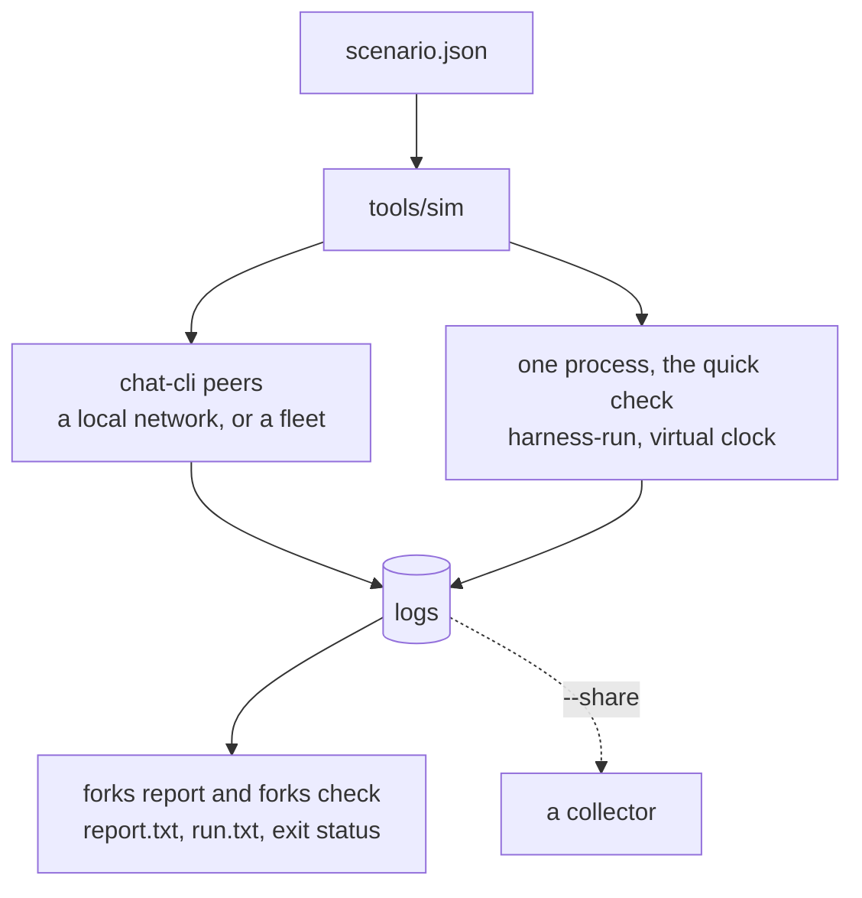

`tools/sim` runs a group the way a scenario file says, on a local network: a headless chat-cli for each
member, each with its own delivery node, on a network that holds the run's nodes and no other. It
collects every member's log and holds the fork report against what the scenario expects. One process is
the quick check.



## Three ways to run

| | Local network | One process | Fleet |
|---|---|---|---|
| Flag | `--chat-cli PATH` | `--one-process PATH` | `--chat-cli PATH`, and `preset` in the scenario |
| Members | a headless chat-cli each, with its own delivery node, and a mock registry | clients in one process | chat-cli peers on `logos.test` |
| Time | real | a virtual clock: seconds of group timers in milliseconds | real |
| For | the real network stack, up to 50 members on one machine | a quick check of a change | the public fleet; not reproducible |

## A first run

```sh
nix build .#logos-delivery
nix develop -c bash -c 'LOGOS_DELIVERY_LIB_DIR=./result/lib cargo build --release -p chat-cli'
nix develop -c python3 tools/sim run tools/sim/scenarios/three.json \
  --chat-cli target/release/chat-cli --out tmp/three
```

```text
3 members, fast group timers, largest message 512 KiB
whole: 3 of 3 members at the tip
the report is as expected
load average 0.45 at the start, 0.42 at the end

node   ready   start  dials  wired  mesh  end  mesh  dialed  failed  refused  dropped  errors  exit
saro  0.089s  0.089s      0      2     2    2     2       0       0        0        0       0     0
raya  0.195s  0.105s      1      2     2    2     2       1       0        0        0       0     0
pax   0.394s  0.199s      2      2     2    2     2       2       0        0        0       0     0

batch  joiners  members  joined  seated  Welcome bytes
1            2        3  0.534s  0.534s       2 x 7121

post  from  read by  median   worst  delivered   worst  lookup
1      pax   2 of 2  0.007s  0.007s     0.007s  0.007s  0.000s
```

The sim starts a mock registry and the peers one after another, each node dialing nodes started before it,
and waits until the nodes are linked.

- The head says the verdict, how many members are at the tip, and whether the report is as expected.
- `node` is each peer: when it was ready and how long it took to start, how many nodes it dialed, its links
  and gossip mesh once wired and at the end, publishes its node `refused`, frames it `dropped` inbound,
  frames its member rejected (`errors`), and how it ended. `dialed` and `failed` are the node's own counts,
  and they also count dials back that leave no link.
- `batch` is each `/add`: how many joined, the group's size after it, how long until the last joiner
  joined and until every member held the roster, and the size of each Welcome.
- `post` is each post: how many read it and how long they took. `delivered` is until each reader's lookup
  of the sender reached the registry, `lookup` the lookup itself.

`--out` must not exist. It holds a `<name>.log` per member (`group.log` in one process), `report.txt` and
`report.json` (the fork report), `expect.json` (what the report was held to), `run.txt` (what was printed)
and `run.json` (the same and more, for scripts).

| Exit | When |
|---|---|
| 0 | every step was done and the report is as the scenario expects |
| 1 | a step was not done, or the report differs |
| 2 | the command line or the scenario is refused; nothing started |
| 128 + n | signal n stopped it; what it measured is written |

A run is judged by the check, not by the report's own exit status: a scenario may expect a verdict other
than `whole`.

## Fifty members

On Linux, give a run of many peers a network namespace of its own: its nodes share ports and loopback with
nothing else on the machine, and reach no other network.

```sh
nix develop -c unshare -rn sh -c 'ip link set lo up && exec "$@"' sim \
  python3 tools/sim run tools/sim/scenarios/fifty.json --chat-cli target/release/chat-cli --out tmp/fifty
```

```text
50 members, group timers voting_delay 1000 ms, consensus_timeout 17500 ms, commit_batch_window 13500 ms, freeze_duration 6500 ms, proposal_expiration 26000 ms, largest message 512 KiB
whole: 50 of 50 members at the tip
the report is as expected
load average 0.13 at the start, 14.27 at the end

node     ready   start  dials  wired  mesh  end  mesh  dialed  failed  refused  dropped  errors                   exit
saro    0.103s  0.103s      0      6     6    6     3      10      10        0        0       0                      0
raya    0.195s  0.091s      1      6     6    6     5      10       9        0        0       0                      0
pax     0.285s  0.090s      1      6     6    6     6      13      12        0        0       0                      0
...
peer48  5.060s  0.105s      5      6     6    6     6       6       1        0        0       0  signal 11 in its stop
peer49  5.170s  0.110s      5      6     6    6     6       6       1        0        0       0                      0
peer50  5.288s  0.117s      6      6     6    6     6       6       0        0        0       0                      0

batch  joiners  members   joined   seated  Welcome bytes
1           10       11  14.171s  14.170s     10 x 28222
2           10       21  15.931s  15.901s     10 x 42191
3           10       31  16.976s  16.968s     10 x 56117
4           10       41  19.836s  19.818s     10 x 70077
5            9       50  18.481s  18.480s      9 x 81290

post    from   read by  median   worst  delivered   worst  lookup
1     peer50  49 of 49  0.036s  0.041s     0.026s  0.037s  0.008s
```

- **Six links a node.** From seven members up every node links to six others, the mesh degree gossipsub aims
  for.
- **Timers sized for fifty.** Each covers twice what a group of fifty needed on one machine;
  `tools/sim/README.md` shows how they were read from the logs. A run takes about a minute and a half.
- **Not every run is whole.** On a machine of 16 cores, 16 of 20 runs went as expected, and the four
  others ended `whole, members behind`, with 3 to 10 members that did not come to hold a batch's roster
  within the budget.
- **`signal 11 in its stop`** is the delivery library crashing as the peer stops, after the run has asked
  its node for the last time. It happens in larger runs and changes nothing the run measured.

## A scenario

```json
{
  "members": 4,
  "budget": 33,
  "network": {"seed": 1, "loss": 0.02, "delay_ms": 40},
  "steps": [
    {"step": "seat", "to": 4, "batch": 2},
    {"step": "post", "from": "all"}
  ]
}
```

Members are named `saro`, `raya`, `pax`, `mira`, `kes`, `tomo`, then `peer7` on. `saro` creates the
group. This one, saved as `four.json`, seats the others two at a time, has every peer lose 2% of the frames
it receives and hold the rest for 40 ms, and has every member post:

```text
4 members, fast group timers, largest message 512 KiB, network seed 1, loss 0.02, welcome loss 0
whole: 4 of 4 members at the tip
the report is as expected
load average 0.38 at the start, 0.38 at the end

node   ready   start  dials  wired  mesh  end  mesh  dialed  failed  refused  dropped  lost  errors  exit
saro  0.095s  0.095s      0      3     3    3     3       0       0        0        0     1       0     0
raya  0.184s  0.089s      1      3     3    3     3       1       0        0        0     0       0     0
pax   0.287s  0.102s      2      3     3    3     3       2       0        0        0     0       0     0
mira  0.384s  0.097s      3      3     3    3     3       3       0        0        0     0       0     0

batch  joiners  members  joined  seated  Welcome bytes
1            2        3  0.610s  0.610s       2 x 7121
2            1        4  0.698s  0.697s       1 x 7276

post  from  read by  median   worst  delivered   worst  lookup
1     saro   3 of 3  0.043s  0.043s     0.042s  0.042s  0.001s
2     raya   3 of 3  0.044s  0.044s     0.043s  0.043s  0.001s
3      pax   3 of 3  0.044s  0.044s     0.043s  0.043s  0.001s
4     mira   3 of 3  0.044s  0.044s     0.043s  0.043s  0.001s
```

With `network`, each peer puts what it receives through chat-cli's model of a lossy network, between its
node and its client, and `lost` counts the frames the model dropped. Nothing brings a lost frame back: the
local network has no store node. A wait that a lost frame leaves open runs to the end of its `budget`,
which is why `four.json` sets 33 s in place of 180.

| Field | Default | Holds |
|---|---|---|
| `members` | | how many members start |
| `steps` | | what they do, in order |
| `timers` | `fast` | `fast`, `default`, or durations in ms over the default set |
| `budget` | `180` | seconds each wait may take |
| `max_message_kib` | `512` | the largest message a node takes; not with `preset`, and no effect in one process |
| `network` | none | `seed`, `loss`, `welcome_loss`, `delay_ms` (one number, or by name) |
| `preset` | none | a fleet to join, such as `logos.test` |
| `expect` | a whole group | how the outcome differs: `verdict`, `positions` by name, `posts` by name |

| Step | Does |
|---|---|
| `seat` `to` `batch` | Saro adds members, `batch` at a time (10 by default), until the group holds `to` |
| `post` `from` | a member posts (`last` seated by default, or `all`), and the others wait for it |
| `hold` `seconds` | nothing, for a while |
| `cut` `between`, `heal` | cut two sides off from each other, and end the cut; need `network` |

Every field is checked before anything starts. The full format, with every field and step, is in
`tools/sim/README.md`.

## Scenarios to start from

| Scenario | Does |
|---|---|
| `three.json` | 3 members in one batch, one post; CI runs it over a local network |
| `twenty.json` | 20 members in two batches of 10 |
| `fifty.json` | 50 members, with timers sized for fifty |
| `lossy.json` | 5 members one at a time, with 5% of frames lost |
| `fleet-five.json` | 5 members on `logos.test`, held for 300 s |

## Sweeps

`sweep` does a scenario `--runs K` times and prints a row as each ends. With `network`, run k takes the
seed `seed + k - 1`.

```sh
nix develop -c python3 tools/sim sweep four.json --runs 5 \
  --chat-cli target/release/chat-cli --out tmp/four-sweep
```

```text
run  seconds  at the tip  verdict                 check
  1      3.2      4 of 4  whole                   as expected; seed 1
  2      3.2      4 of 4  whole                   as expected; seed 2
  3     35.3      3 of 4  whole, members behind   verdict: whole, members behind, expected whole, and 5 more; stopped: raya: no line of a new roster within the budget; seed 3
  4      3.2      4 of 4  whole                   as expected; seed 4
  5      3.2      4 of 4  whole                   as expected; seed 5
4 of 5 runs went as expected
```

In run 3 Raya's model lost two of Saro's frames, and Raya never held the roster that seats Mira. A run
that went otherwise names its first difference from the expectation in the `check` column, and the reason
a step stopped. Each run keeps its own directory under `--out`, and `sweep.txt` and `sweep.json` hold the
rows. A seed does not replay a run: ids are random, and with them which commit applies.

## One process, the quick check

```sh
cargo build --release -p integration_tests_core --bin harness-run
python3 tools/sim run tools/sim/scenarios/twenty.json \
  --one-process target/release/harness-run --out tmp/twenty
```

```text
20 members, fast group timers, one process, 1.950s on a virtual clock in 0.323s of wall time
whole: 20 of 20 members at the tip
the report is as expected
load average 0.11 at the start, 0.11 at the end

member  installation  errors
saro        84f2f26a       0
raya        2357f4ef       0
pax         850fadf6       0
...
peer20      d0f0ef3c       0

batch  joiners  members  seated
1           10       11  1.250s
2            9       20  0.550s

post    from   read by  median   worst
1     peer20  19 of 19  0.000s  0.000s
```

Every member is a client in one process, and the group's timers run on a virtual clock: twenty members in
a third of a second, with Rust and `protoc`, and no Nix. No delivery node is between the members, so there
is no `node` table and no Welcome size; a frame is lost or late where the network model makes it so and
nowhere else. Every member writes into `group.log`. `sweep` takes `--one-process` as `run` does.

## In CI

| Job | Runs |
|---|---|
| Fork Report | the forks tests, then the GroupV2 scale test with `LOG=info`, and `forks report` on its log, which must read `whole` |
| Sim | the sim's tests |
| Smoketest | `three.json` over a local network of chat-cli peers, on Linux and macOS |
