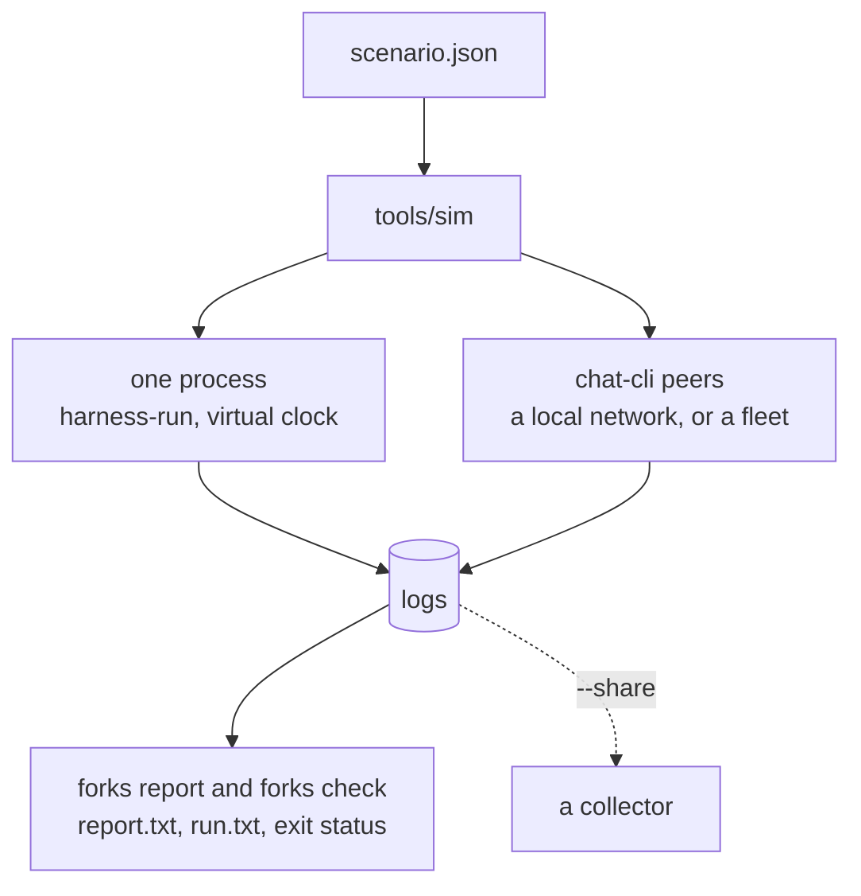

`tools/sim` runs a group the way a scenario file says, collects every member's log, and holds the fork
report against what the scenario expects.



## Three ways to run

| | One process | Local network | Fleet |
|---|---|---|---|
| Flag | `--one-process PATH` | `--chat-cli PATH` | `--chat-cli PATH`, and `preset` in the scenario |
| Members | clients in one process | a headless chat-cli each, with its own delivery node, and a mock registry | chat-cli peers on `logos.test` |
| Time | a virtual clock: seconds of group timers in milliseconds | real | real |
| For | many runs, large groups, every change | the real network stack on one machine | the public fleet; not reproducible |

## A first run

```sh
cargo build --release -p integration_tests_core --bin harness-run
python3 tools/sim run tools/sim/scenarios/twenty.json \
  --one-process target/release/harness-run --out tmp/twenty
```

```text
20 members, fast group timers, one process, 1.950s on a virtual clock in 0.323s of wall time
whole: 20 of 20 members at the tip
the report is as expected
load average 0.11 at the start, 0.11 at the end

member  installation  errors
saro        84f2f26a       0
raya        2357f4ef       0
pax         850fadf6       0
...
peer20      d0f0ef3c       0

batch  joiners  members  seated
1           10       11  1.250s
2            9       20  0.550s

post    from   read by  median   worst
1     peer20  19 of 19  0.000s  0.000s
```

- The head says the verdict, how many members are at the tip, and whether the report is as expected.
- `member` maps names to installations; `errors` counts the frames each rejected.
- `batch` is each `/add`: how many joined, the group's size after it, how long until every member held
  the roster.
- `post` is each post: how many read it, and how long they took.

`--out` must not exist. It holds the logs (`group.log` in one process, a `<name>.log` per member over
chat-cli), `report.txt` and `report.json` (the fork report), `expect.json` (what the report was held to),
`run.txt` (what was printed) and `run.json` (the same and more, for scripts).

| Exit | When |
|---|---|
| 0 | every step was done and the report is as the scenario expects |
| 1 | a step was not done, or the report differs |
| 2 | the command line or the scenario is refused; nothing started |
| 128 + n | signal n stopped it; what it measured is written |

A run is judged by the check, not by the report's own exit status: a scenario may expect a verdict other
than `whole`.

## A scenario

```json
{
  "members": 4,
  "network": {"seed": 1, "delay_ms": {"pax": 200}},
  "steps": [
    {"step": "seat", "to": 4, "batch": 2},
    {"step": "post", "from": "all"}
  ]
}
```

Members are named `saro`, `raya`, `pax`, `mira`, `kes`, `tomo`, then `peer7` on. `saro` creates the
group. This one seats the others two at a time, delays what reaches Pax by 200 ms, and has every member
post:

```text
4 members, fast group timers, one process, 3.100s on a virtual clock in 0.026s of wall time, network seed 1, loss 0, welcome loss 0
whole: 4 of 4 members at the tip
the report is as expected
load average 0.16 at the start, 0.16 at the end

member  installation  arrived  passed  held  lost  errors
saro        dc2e086b       13      13     0     0       0
raya        4d926b82       17      17     0     0       0
pax         a75fac72       16      16     0     0       0
mira        e54dd7e0        9       9     0     0       0

batch  joiners  members  seated
1            2        3  1.450s
2            1        4  0.750s

post  from  read by  median   worst
1     saro   3 of 3  0.000s  0.200s
2     raya   3 of 3  0.000s  0.200s
3      pax   3 of 3  0.000s  0.000s
4     mira   3 of 3  0.000s  0.200s
```

With `network`, each member's model counts the frames that `arrived`, that it `passed` on, `held` at the
end and `lost`.

| Field | Default | Holds |
|---|---|---|
| `members` | | how many members start |
| `steps` | | what they do, in order |
| `timers` | `fast` | `fast`, `default`, or durations in ms over the default set |
| `budget` | `180` | seconds each wait may take |
| `max_message_kib` | `512` | the largest message a node takes; not with `preset`, and no effect in one process |
| `network` | none | `seed`, `loss`, `welcome_loss`, `delay_ms` (one number, or by name) |
| `preset` | none | a fleet to join, such as `logos.test` |
| `expect` | a whole group | how the outcome differs: `verdict`, `positions` by name, `posts` by name |

| Step | Does |
|---|---|
| `seat` `to` `batch` | Saro adds members, `batch` at a time (10 by default), until the group holds `to` |
| `post` `from` | a member posts (`last` seated by default, or `all`), and the others wait for it |
| `hold` `seconds` | nothing, for a while |
| `cut` `between`, `heal` | cut two sides off from each other, and end the cut; need `network` |

Every field is checked before anything starts. The full format, with every field and step, is in
`tools/sim/README.md`.

## Scenarios to start from

| Scenario | Does |
|---|---|
| `three.json` | 3 members in one batch, one post; CI runs it over a local network |
| `twenty.json` | 20 members in two batches of 10 |
| `fifty.json` | 50 members, with timers sized for fifty |
| `lossy.json` | 5 members one at a time, with 5% of frames lost |
| `fleet-five.json` | 5 members on `logos.test`, held for 300 s |

## Sweeps

`sweep` does a scenario `--runs K` times and prints a row as each ends. With `network`, run k takes the
seed `seed + k - 1`.

```sh
python3 tools/sim sweep tools/sim/scenarios/twenty.json --runs 5 \
  --one-process target/release/harness-run --out tmp/twenty-sweep
```

```text
run  seconds  at the tip  verdict                 check (one process: seconds of its virtual clock)
  1      1.9    20 of 20  whole                   as expected
  2      1.9    20 of 20  whole                   as expected
  3      1.9    20 of 20  whole                   as expected
  4      1.9    20 of 20  whole                   as expected
  5      1.9    20 of 20  whole                   as expected
5 of 5 runs went as expected
```

A run that went otherwise names its first difference from the expectation in the `check` column, and the
reason a step stopped. Each run keeps its own directory under `--out`, and `sweep.txt` and `sweep.json`
hold the rows. A seed does not replay a run: ids are random, and with them which commit applies.

## Over a network of chat-cli peers

```sh
nix build .#logos-delivery
nix develop -c bash -c 'LOGOS_DELIVERY_LIB_DIR=./result/lib cargo build --release -p chat-cli'
nix develop -c python3 tools/sim run tools/sim/scenarios/three.json \
  --chat-cli target/release/chat-cli --out tmp/three
```

The sim starts a mock registry and one headless chat-cli per member, each with its own delivery node on
loopback, and waits until the nodes are linked. `run.txt` adds a table of the nodes and the size of each
Welcome. On Linux, give a run of many peers a network namespace of its own; `tools/sim/README.md` shows
how.

## In CI

| Job | Runs |
|---|---|
| Fork Report | the forks tests, then the GroupV2 scale test with `LOG=info`, and `forks report` on its log, which must read `whole` |
| Sim | the sim's tests |
| Smoketest | `three.json` over a local network of chat-cli peers, on Linux and macOS |
